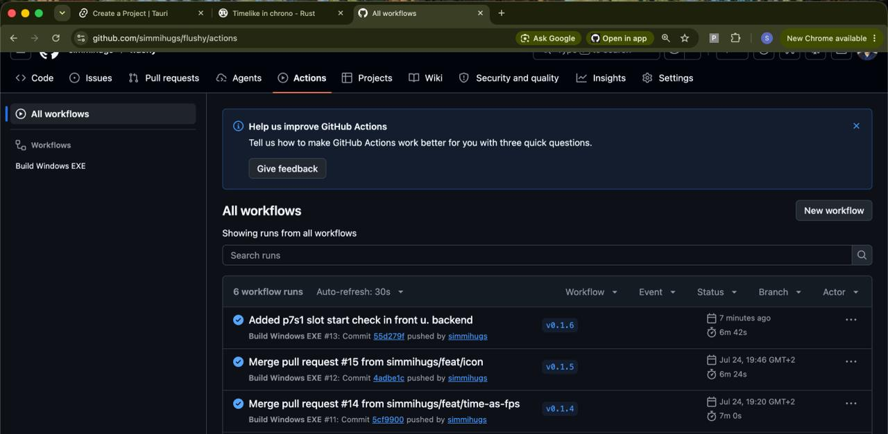
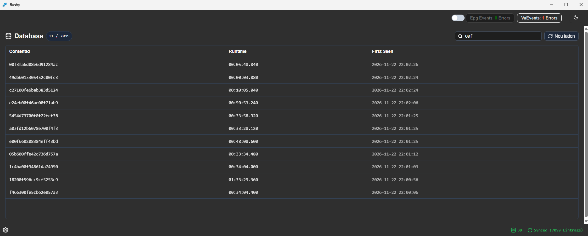
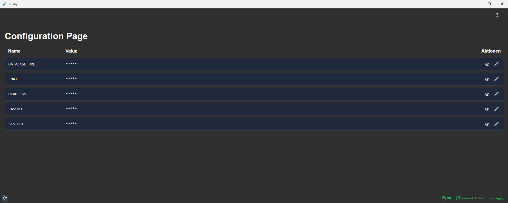
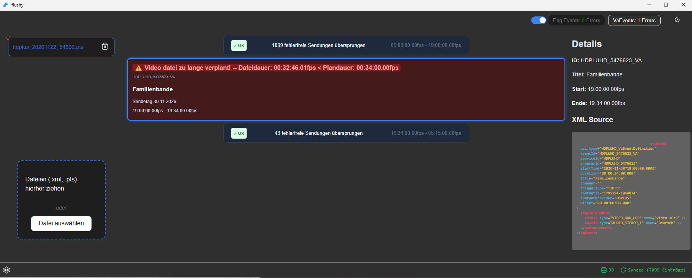

#+TTILE: Pts export verifier

** dev mode
   #+begin_src shell
     npm run tauri dev 
   #+end_src

** Issue a new release   
   1. Had to github and merge feature/bug fix into main.
   2. Locally, add new tag and push
      #+begin_src shell
        git tag v0.1.*
        git push origin v0.1.*
      #+end_src
   3. See built process
      
** test suite

*** test for xml behavior
    Enter rust/tauri src
    #+begin_src shell
      cd src-tauri
    #+end_src
        
    Base command is ~cargo test~

    #+begin_src shell
      ╭[simmi@Simons-MBP] ~/Projects/flushy/src-tauri
      ╰─> PTS_TEST_FILE=/Users/simmi/Downloads/hdplus_20261121_54847.pts  cargo test real_file -- --nocapture                                                                                                                                  ✨🐱🎉😎 ⎇  on branch fix/test-suite
         Compiling flushy v0.1.16 (/Users/simmi/Projects/flushy/src-tauri)
          Finished `test` profile [unoptimized + debuginfo] target(s) in 5.96s
           Running unittests src/lib.rs (target/debug/deps/flushy_lib-e286ae38a9ee285d)

      running 1 test
      [2026-11-22 23:39:18.503] [INFO] [events] Geparst: /Users/simmi/Downloads/hdplus_20261121_54847.pts (SI: 178, VA: 1000, SI-Errors: 0, VA-Errors: 0, Maybes: 292)
      178 si_events, 1000 va_events
      test events::tests::real_file_smoke_test ... ok

      test result: ok. 1 passed; 0 failed; 0 ignored; 0 measured; 14 filtered out; finished in 0.06s

           Running unittests src/main.rs (target/debug/deps/flushy-d5480320563acb91)

      running 0 tests

      test result: ok. 0 passed; 0 failed; 0 ignored; 0 measured; 0 filtered out; finished in 0.00s

      ╭[simmi@Simons-MBP] ~/Projects/flushy/src-tauri
      ╰─>                                                                                                                                                                                                                                      ✨🐱🎉😎 ⎇  on branch fix/test-suite
    #+end_src

** UI
   
*** Database view
    

*** Config view
    
    
*** File view
    

