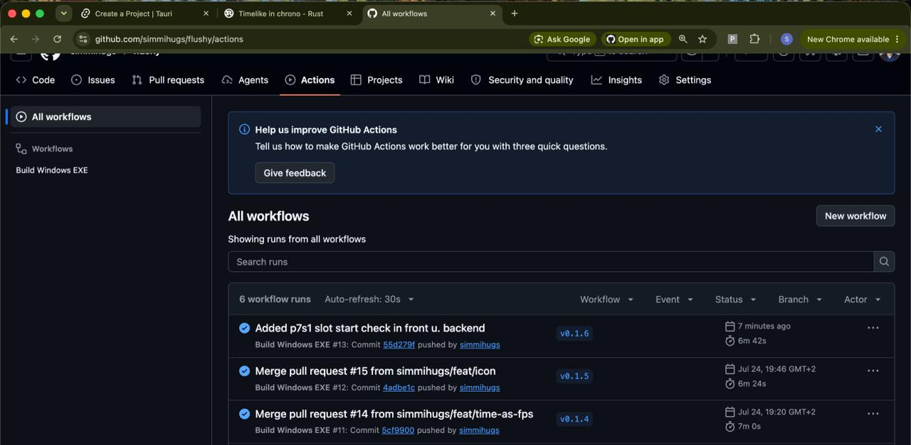
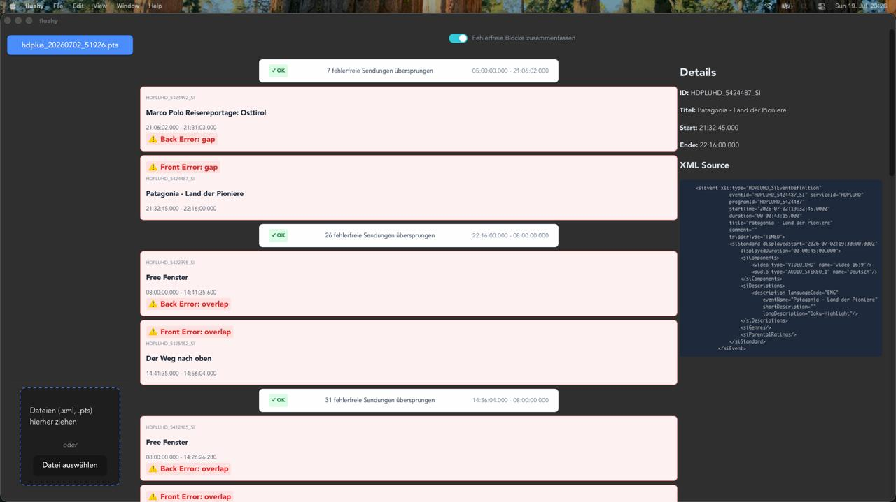

#+TTILE: Pts export verifier

** dev mode
   #+begin_src shell
     npm run tauri dev 
   #+end_src

** Issue a new release   
   1. Had to github and merge feature/bug fix into main.
   2. Locally, add new tag and push
      #+begin_src shell
        git tag v0.1.*
        git push origin v0.1.*
      #+end_src
   3. See built process
      
** test suite

*** test for xml behavior
    #+begin_src shell
      cd src-tauri
      cargo test -- --nocapture
    #+end_src

    #+begin_src shell
      cargo test  
    #+end_src

** UI
   

